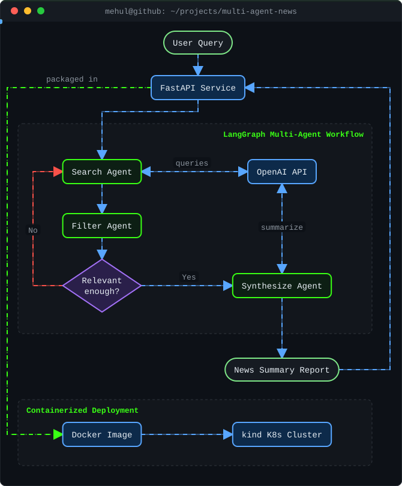
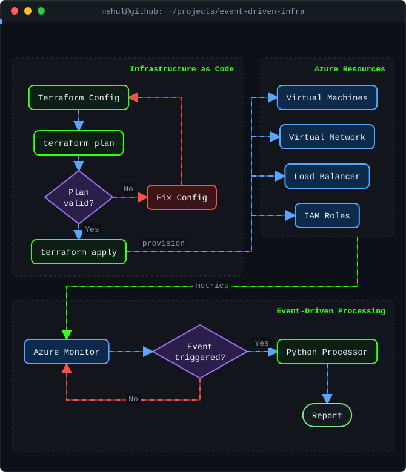
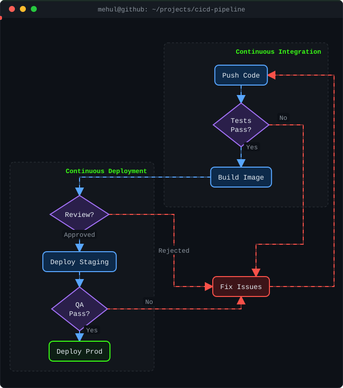

---

## `$ featured_projects`

### 01. Multi-Agent News Automation Pipeline

`Python` `LangChain` `LangGraph` `OpenAI API` `FastAPI` `Docker` `Kubernetes`

- Automated multi-step research workflow: Search → Filter → Synthesize using LangGraph.
- Exposed through a FastAPI service, containerized with Docker.
- Deployed and tested on a local Kubernetes (kind) cluster.

### 02. Event-Driven Cloud Infrastructure Pipeline

`Terraform` `Azure` `Python` `Cloud Infrastructure`

- Automated infrastructure provisioning using Terraform.
- Worked with virtual machines, networks, load balancers and IAM.
- Reduced manual provisioning effort by 70%.
- Integrated event-driven processing and reporting, monitored with Azure Monitor.

### 03. CI/CD Pipeline Design (what I am building towards)

`Docker` `Kubernetes` `Jenkins` `GitOps`

---

## `$ professional_experience`

### System Administrator — CloudDrove

- Linux server administration and process monitoring.
- Networking and infrastructure troubleshooting.
- Infrastructure provisioning using Terraform.
- Server monitoring and operational support.
- Collaboration with teams on infrastructure delivery.

---

## `$ certifications`

- Microsoft Certified: Azure Fundamentals (AZ-900)
- OCI Networking Professional
- OCI DevOps Professional

## `$ education`

**B.Tech — Computer Science (2022–2026)** — Pranveer Singh Institute of Technology

---

## `$ github_statistics`

  
  

  

---

---

## `$ connect_with_me`

-  LinkedIn: [Connect with me](https://www.linkedin.com/in/mehul-srivastava-ab2538299/)
-  GitHub: [mehul-srivastava-code](https://github.com/mehul-srivastava-code)
-  Email: [mehul28000@gmail.com](mailto:mehul28000@gmail.com)

